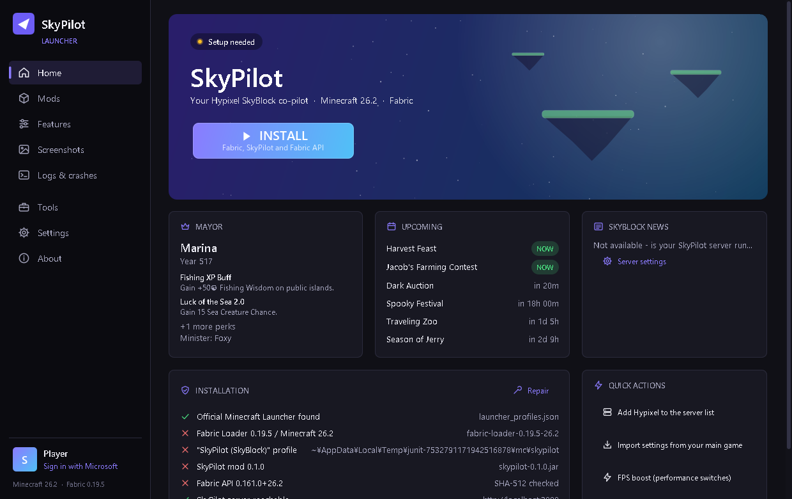
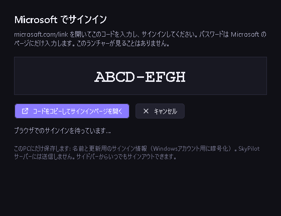

# SkyPilot Launcher

A desktop launcher for **Minecraft: Java Edition 26.2 with Fabric**, made for players of the
Hypixel SkyBlock server. It installs the SkyPilot client-side helper mod and starts the game.

## What it does

- Installs Fabric Loader, the SkyPilot mod and Fabric API (each checked against a pinned hash).
- Downloads the game files and Java runtime **only from Mojang's official servers** and checks
  every file against the SHA-1 published by Mojang.
- Lets players who own Minecraft sign in with **their own Microsoft account** and start the game.
- Manages mods, logs, crash explanations, screenshots and settings backups.
- Can also prepare a profile for the official Minecraft Launcher instead.

## Microsoft sign-in

The launcher uses the standard Microsoft identity platform flow for Minecraft:

1. OAuth 2.0 **device code flow** (`login.microsoftonline.com/consumers`, scope
   `XboxLive.signin offline_access`). The player opens `microsoft.com/link`, types the code and
   signs in **on Microsoft's own page**. The launcher never asks for or sees a password.
2. Xbox Live → XSTS (`rp://api.minecraftservices.com/`) → `login_with_xbox`.
3. `/minecraft/profile` on `api.minecraftservices.com`. Accounts that do not own the game cannot
   start it.

## Privacy and security

| Data | Where it is kept |
|---|---|
| Player name and UUID | On the player's PC (shown in the launcher) |
| Microsoft refresh token | On the player's PC only, encrypted with Windows DPAPI for the current Windows user |
| Minecraft access token | In memory only, passed only to the game process |

- Tokens are **never sent to our servers or any third party**, and never written to logs.
- "Sign out" deletes the saved sign-in.
- The launcher does **not** bypass any security, authentication or license checks, does not
  offer offline/cracked play for online servers, and does not disable safety features.
- The SkyPilot mod contains no automation (no macros, auto-clickers or movement automation) and
  never handles passwords or tokens.
- Launcher updates are installed only when they carry a valid Ed25519 signature, and only after
  the player clicks "Install".

## Status

Windows. Currently a small project used by the developer and a few friends; the source code is
kept in a private repository.

---

SkyPilot is not affiliated with or endorsed by Mojang Studios, Microsoft or Hypixel.
Minecraft is a trademark of Mojang Studios.
